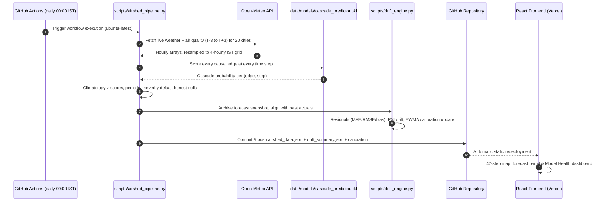

# NAICEWS — National Airshed Intelligence & Cascade Early-Warning System

PM2.5 forecasting and cross-city pollution-transport ("cascade") alerting for 20
Indian cities, with a self-correcting drift-monitoring and adaptive-callibration
layer



## Feature overview

### Backend pipeline (`scripts/`)

| Feature | Where | What it does |
|---|---|---|
| Multi-city live ingestion | `airshed_pipeline.py` | Parallel fetch (8 threads) of weather + air quality for 20 cities via a shared cached/retried HTTP session |
| 4-hourly IST grid | `airshed_pipeline.py`, `tz.py` | Canonical IST timezone; slot alignment correct on both local machines and UTC CI runners |
| Seasonal climatology | `build_climatology.py` | Per-city / per-month / per-hour PM2.5 baseline from the 3-year parquet — powers anomaly z-scores |
| Airshed clustering | `cluster_airsheds.py`, `01_cluster_airsheds.ipynb` | Soft-DTW time-series clustering → 4 meteorological regimes |
| Causal transport graph | `compute_causal_graph.py` | De-seasonalised cross-correlation + Granger tests, Benjamini–Hochberg FDR correction, corridor bearings, transmission-type taxonomy (Synoptic / Advective / Meso / Long-Range) |
| Cascade classifier | `02_train_cascade_model.ipynb` | LightGBM with calibration and validation-tuned decision threshold; predicts severe-PM2.5 arrival per edge |
| Per-edge severity deltas | `build_edge_deltas.py` | Historical conditional impact: mean ΔPM2.5 at target given a source trigger, per edge |
| Operational inference | `airshed_pipeline.py` | 42 time steps (T-3 → T+3), model-scored cascade pulses with ETA + confidence, `data_available` flags and nulls (never fabricated zeros) |
| Drift engine | `drift_engine.py` | Archives forecast snapshots, aligns them against later actuals, computes MAE / RMSE / bias per city and horizon, PSI feature drift |
| Adaptive calibration | `drift_engine.py` | EWMA bias correction per city × horizon (24/48/72 h), clamped to ±25 µg/m³, applied to future forecasts between retrains |
| Payload validation | `validate_payload.py` | JSON-schema gate on `airshed_data.json` before any commit |
| Smoke & unit tests | `tests/` | Payload contract tests (42 steps, 20 cities, no fabricated zeros, model wired, not stale) + drift-engine unit tests |

### Frontend dashboard (`web_app/`)

React 19 + Vite + MapLibre GL + Zustand + ECharts + TanStack Query.

- **Operational map console** — 6 stacked layers: cluster envelopes (smoothed
  convex-hull airshed basins), IDW-interpolated pollution raster, Bézier
  transport streamlines with ETA badges, station pins with breathing hazard
  rings, animated cascade pulse particles, and a 60 FPS wind-particle overlay.
- **42-step time controller** — scrub across T-3 → T+3 in 4-hour slots
  (Night → Evening), with observed/forecast distinction.
- **Forecast panel** — per-city sub-daily CHHI/AQI/PM2.5 trajectory charts
  (ECharts) with hazard categorisation and "No Station Data" handling.
- **Model Health & Drift Dashboard** — 30-day MAE/RMSE/bias trend chart, PSI
  drift metrics, per-city performance ranking, and live calibration-layer
  status, fed by `drift_summary.json`.
- **Layer & metric controls** — toggle any map layer; switch the colour metric
  between CHHI, AQI, PM2.5 and NO2.
- **Staleness guard** — the UI flags data older than the payload's declared
  freshness window (`staleness_max_hours`).

### Automation (`.github/workflows/airshed_cron.yml`)

Daily at 00:00 IST (18:30 UTC) + manual dispatch: install pinned deps →
run inference pipeline → run drift engine → schema-validate payloads →
pytest smoke tests → auto-commit updated payloads, calibration layer and
drift archive → Vercel redeploys the frontend automatically.

## Project structure

```
scripts/
  fetch_historical.py        # build the 3-year 4-hourly training parquet
  build_climatology.py       # seasonal PM2.5 baseline (per city/month/hour)
  cluster_airsheds.py        # Soft-DTW time-series clustering -> 4 airsheds
  compute_causal_graph.py    # deseasonalised CCF + Granger + FDR -> transport edges
  build_edge_deltas.py       # per-edge historical impact statistics
  airshed_pipeline.py        # PRODUCTION inference (runs on the cron)
  drift_engine.py            # residual tracking, PSI, EWMA calibration layer
  validate_payload.py        # JSON schema checks (runs in CI)
  verify_graph.py / verify_ingestion.py / plot_clusters.py   # dev tools
notebooks/
  01_cluster_airsheds.ipynb     # airshed clustering (artifacts in data/)
  02_train_cascade_model.ipynb  # trains + calibrates the cascade classifier
data/
  processed/                 # master_multi_city_4h.parquet (training data)
  models/                    # cascade_predictor.pkl, causal_graph.json,
                             # pm25_climatology.json, edge_severity_deltas.json,
                             # calibration_layer.json, dtw_clusters.pkl
  drift/                     # forecast snapshots + drift_log.jsonl (appended by CI)
tests/                       # smoke tests + drift-engine unit tests (run in CI)
web_app/                     # React + Vite dashboard (map, forecast, drift UI)
docs/                        # model ops, plans, cascade audit
```

## ML workflow

1. **Cluster airsheds** — `notebooks/01_cluster_airsheds.ipynb`: unsupervised
   Soft-DTW clustering of the 20 city series into 4 regimes
   (`data/models/dtw_clusters.pkl`).
2. **Mine the transport graph** — `scripts/compute_causal_graph.py`:
   de-seasonalised cross-correlation + Granger tests with FDR correction build
   the directed network (`data/models/causal_graph.json`).
3. **Train the cascade model** — `notebooks/02_train_cascade_model.ipynb`:
   calibrated LightGBM predicting severe-PM2.5 arrival at each edge's target
   (`data/models/cascade_predictor.pkl`).
4. **Daily inference + self-correction** — `scripts/airshed_pipeline.py` +
   `scripts/drift_engine.py`: model-scored cascade pulses, climatology
   anomalies, per-edge severity deltas; then residual tracking, PSI drift
   detection and an EWMA bias-calibration layer that adapts forecasts between
   retrains.

Retraining cadence, PSI thresholds and the rollback procedure are documented
in [docs/model_ops.md](docs/model_ops.md).
