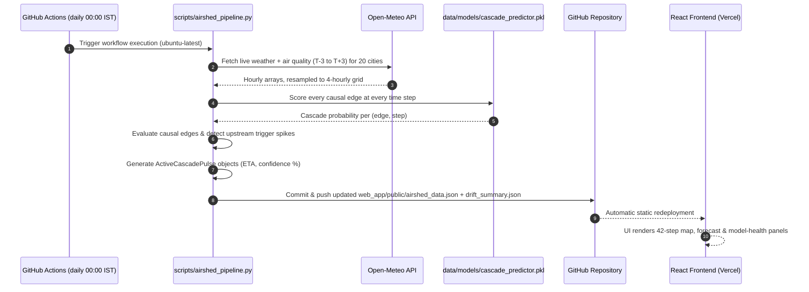

# NAICEWS — National Airshed Early Warning System

PM2.5 forecasting and cross-city pollution-transport ("cascade") alerting for 20
Indian cities, with a drift-monitoring layer that self-corrects the forecasts.



## Project structure

```
scripts/
  fetch_historical.py        # build the 3-year 4-hourly training parquet
  build_climatology.py       # seasonal PM2.5 baseline (per city/month/hour)
  cluster_airsheds.py        # Soft-DTW time-series clustering -> 4 airsheds
  compute_causal_graph.py    # cross-correlation + Granger -> transport edges
  build_edge_deltas.py       # per-edge historical impact statistics
  airshed_pipeline.py        # PRODUCTION inference (runs on the cron)
  drift_engine.py            # residual tracking, PSI, EWMA calibration layer
  validate_payload.py        # JSON schema checks (runs in CI)
  verify_graph.py / verify_ingestion.py / plot_clusters.py   # dev tools
notebooks/
  01_cluster_airsheds.ipynb  # airshed clustering (already run; artifacts in data/)
  02_train_cascade_model.ipynb  # trains + calibrates the cascade classifier
data/
  processed/                 # master_multi_city_4h.parquet (training data)
  models/                    # versioned artifacts (model, graph, climatology...)
  drift/                     # forecast snapshots + drift log (appended by CI)
tests/                       # smoke tests (run in CI)
web_app/                     # React + Vite dashboard
docs/                        # model ops, plans, changelog
```

## ML workflow

1. `notebooks/01_cluster_airsheds.ipynb` — unsupervised Soft-DTW clustering of
   the 20 city series into 4 airsheds (`data/models/dtw_clusters.pkl`).
2. `scripts/compute_causal_graph.py` — deseasonalised cross-correlation +
   Granger tests build the directed transport network
   (`data/models/causal_graph.json`).
3. `notebooks/02_train_cascade_model.ipynb` — trains a LightGBM classifier
   (Platt-calibrated, threshold tuned on a validation year) that predicts
   severe-PM2.5 arrival at the target end of each edge
   (`data/models/cascade_predictor.pkl`).
4. `scripts/airshed_pipeline.py` + `scripts/drift_engine.py` — daily inference,
   residual tracking (MAE/RMSE/bias), PSI drift detection, and an EWMA bias
   calibration layer that adapts forecasts between retrains.

Run everything with `pip install -r requirements.txt`; retrain by executing the
notebooks top-to-bottom, then run the pipeline once locally to verify.
